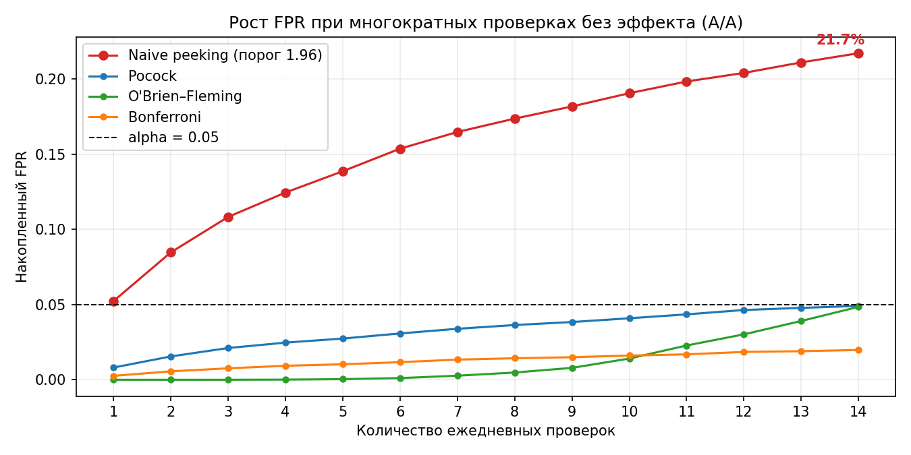
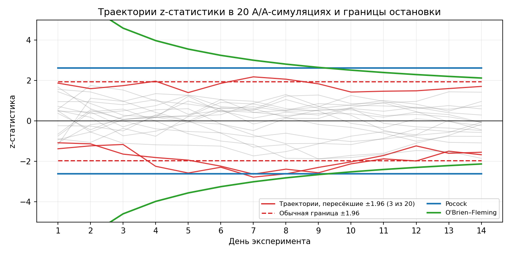

# Peeking в A/B-тестах: почему нельзя подглядывать в p-value

Симуляция A/A-тестов, которая показывает, как ежедневная проверка p-value
раздувает долю ложноположительных результатов, и сколько стоит корректный
контроль ошибки I рода.

## TL;DR

При ежедневной проверке p-value с порогом 1.96 (14 дней, α = 5%,
360 пользователей в день на группу, бинарная конверсия) FPR в A/A-тесте
растёт с 5% до **~22%**. Корректные sequential-границы (Pocock,
O'Brien-Fleming) возвращают FPR к 5% ценой небольшой потери мощности;
OBF теряет меньше всех.

> **Оговорка про 22%.** Это FPR для конкретной конфигурации: 14 равноотстоящих
> проверок, α = 5%, 360 пользователей/день, бинарная метрика. При другом числе
> проверок, α или размере выборки значение изменится (например, 7 дней → ~14–15%,
> 30 дней → 30%+). Устойчиво другое: **peeking раздувает FPR в несколько раз
> относительно α** — это фундаментальное свойство объединения проверок,
> а не артефакт параметров.

## Проблема

Если смотреть на p-value каждый день и останавливать тест при первой
«значимости», вероятность хотя бы одного ложного срабатывания за весь тест
перестаёт контролироваться на уровне α. Каждая проверка даёт случайности
новый шанс пересечь порог, а накопленные данные делают эти шансы зависимыми.
В результате FPR растёт, и решение «остановить тест» становится нечестным.

## Что сделано

- Симуляция 10 000 A/A-тестов: 14 дней, 5 040 пользователей на группу, α = 5%.
- Сравнение правил остановки: fixed, naive peeking, Pocock, O'Brien-Fleming,
  Bonferroni.
- Калибровка границ Pocock/OBF симуляцией (без готовых таблиц) и проверка
  на независимой выборке.
- Оценка мощности при реальном эффекте 10% → 12% и среднего числа дней
  до остановки.
- Расчёт необходимого размера выборки под MDE.

## Результаты

| Метод | FPR без эффекта | Мощность при 10% → 12% | Среднее дней до остановки |
|---|---|---|---|
| Fixed (только день 14) | ~5.0% | ~89% | 14.0 |
| Naive peeking (порог 1.96 каждый день) | **~21.7%** | ~93% (нечестно) | ~5.7 |
| Pocock (c ≈ 2.62) | ~4.9% | ~79% | ~8.5 |
| O'Brien-Fleming (c ≈ 2.13) | ~4.9% | ~88% | ~9.9 |
| Bonferroni (z ≈ 2.91) | ~2.0% | ~69% | ~9.8 |

**Главный вывод.** Naive peeking формально мощнее всех, но при FPR ~22% это
не мощность, а инфляция ложных открытий: примерно каждое пятое «открытие»
в A/A-тесте ложно. Среди честных методов (FPR ≤ α) O'Brien-Fleming почти
не теряет мощность относительно fixed-теста и при этом в среднем
останавливает тест на ~4 дня раньше.

## Графики





## Как запустить

Нужны Python 3.10+ и пакеты `numpy`, `pandas`, `matplotlib`, `scipy`, `jupyter`:

```bash
pip install numpy pandas matplotlib scipy jupyter
jupyter notebook peeking_simulation.ipynb
