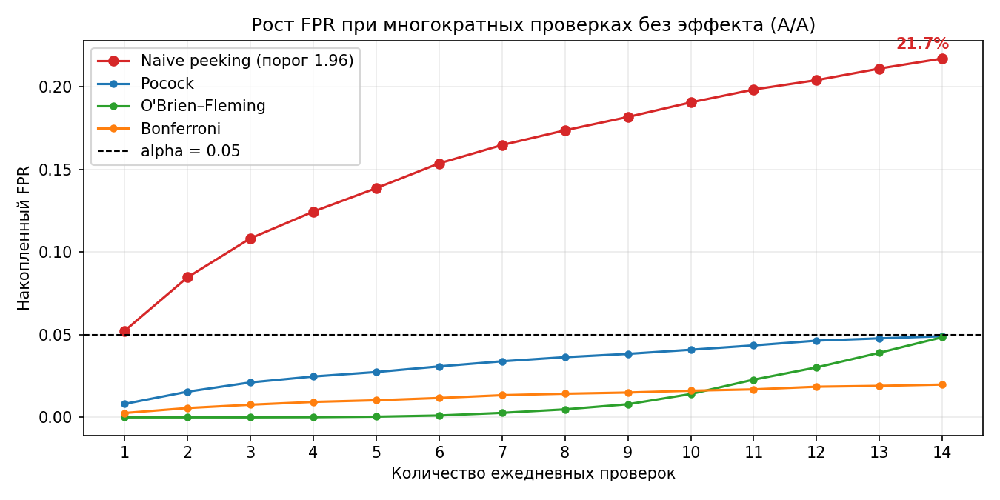
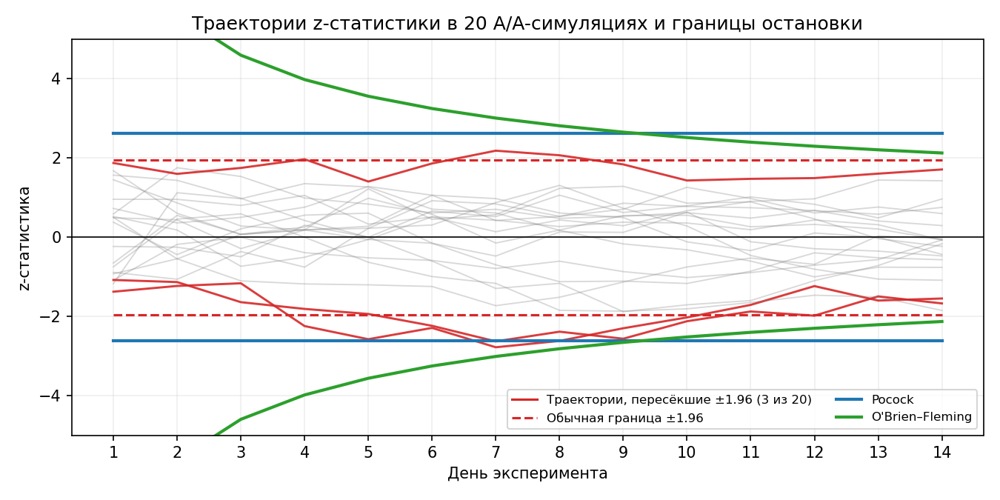

# Peeking в A/B-тестах: почему нельзя подглядывать в p-value

Симуляция A/A-тестов, которая показывает, как ежедневная проверка p-value
раздувает долю ложноположительных результатов, и сколько стоит корректный
контроль ошибки I рода.

## TL;DR

При ежедневной проверке p-value с критическим значением z = 1.96 (14 дней, α = 5%,
360 пользователей в день на группу → 5 040 на группу, бинарная метрика —
конверсия) FPR в A/A-тесте растёт с 5% до **~22%**. Корректные sequential-границы
(Pocock, O'Brien-Fleming) возвращают FPR к 5% ценой небольшой потери мощности;
OBF теряет меньше всех **среди методов с честным контролем FPR**.

> **Оговорка про 22%.** Это FPR для конкретной конфигурации: 14 равноотстоящих
> проверок, α = 5%, 360 пользователей/день, бинарная метрика. При другом числе
> проверок, α или размере выборки значение изменится (например, при 7 проверках
> FPR будет ниже, при 30 — выше; растёт монотонно с числом проверок). Устойчиво
> другое: **peeking раздувает FPR в несколько раз относительно α** — это
> фундаментальное свойство объединения проверок, а не артефакт параметров.

## Проблема

Если смотреть на p-value каждый день и останавливать тест при первой
«значимости», вероятность хотя бы одного ложного срабатывания за весь тест
перестаёт контролироваться на уровне α. Каждая проверка даёт случайности
новый шанс пересечь порог, а накопленные данные делают эти шансы зависимыми.
В результате FPR растёт, и решение «остановить тест» становится нечестным.

## Что сделано

- Симуляция 10 000 A/A-тестов: 14 дней, 5 040 пользователей на группу, α = 5%.
- Сравнение правил остановки: fixed, naive peeking, Pocock, O'Brien-Fleming,
  Bonferroni.
- Калибровка границ Pocock/OBF симуляцией и сверка с табличными значениями
  (Pocock ≈ 2.61, OBF ≈ 2.13 для 14 равноотстоящих проверок); проверка
  на независимой выборке.
- Оценка мощности при реальном эффекте 10% → 12% и среднего числа дней
  до остановки.
- Расчёт необходимого размера выборки под MDE.

## Результаты

| Метод | FPR без эффекта | Мощность при 10% → 12% | Среднее дней до остановки |
|---|---|---|---|
| Fixed (только день 14) | ~5.0% | ~89% | 14.0 |
| Naive peeking (z = 1.96 каждый день) | **~21.7%** | ~93% (нечестно) | ~5.7 |
| Pocock (c ≈ 2.62) | ~4.9% | ~79% | ~8.5 |
| O'Brien-Fleming (c ≈ 2.13) | ~4.9% | ~88% | ~9.9 |
| Bonferroni (z ≈ 2.91) | ~2.0% | ~69% | ~9.8 |

**Размер выборки.** Для MDE 10% → 12% при мощности 80% нужно ~3 840 пользователей
на группу; у нас 5 040 — теоретическая мощность fixed-теста ~89%.

**Главный вывод.** Naive peeking формально мощнее всех, но при FPR ~22% это
не мощность, а инфляция ложных открытий: примерно каждое пятое **срабатывание**
в A/A-тесте ложно (по определению FPR — эффекта нет вообще, значит любое
«открытие» ложно). Среди методов, которые удерживают FPR на уровне α или ниже,
O'Brien-Fleming почти не теряет мощность относительно fixed-теста и при этом
в среднем останавливает тест на ~4 дня раньше.

## Графики



*Накопленный FPR растёт с 5% до 22% при naive peeking, остаётся ~5% для
Pocock, OBF и Bonferroni.*



*Траектории z-статистики в 20 A/A-симуляциях; красным — те, что хотя бы раз
пересекли z = ±1.96. При ежедневном peeking каждая из них была бы объявлена
«успешным» тестом, хотя эффекта нет.*

## Ограничения

- Один сценарий эффекта (10% → 12%); для полной картины нужна кривая мощности
  по нескольким MDE.
- Границы Pocock и OBF откалиброваны под 14 равноотстоящих проверок; при другом
  расписании проверок константы нужно пересчитать.
- Оценки получены методом Монте-Карло и имеют погрешность порядка ±0.2 п.п.
  для FPR около 5%.
- Моделируется сравнение двух бинарных долей z-тестом с равномерным притоком
  пользователей; реальные ratio-метрики и неравномерный трафик требуют
  отдельного анализа.

## Что дальше

- В проде — alpha-spending (Lan-DeMets) вместо фиксированных границ: работает
  при неравномерном трафике, когда information fraction не привязана к номеру дня.
- Проверить на реальных данных с ratio-метриками (не только с бинарными).
- Добавить CUPED для снижения дисперсии и роста мощности без потери контроля FPR.

## Как запустить

Нужны Python 3.10+ (проверено на 3.12) и пакеты `numpy`, `pandas`, `matplotlib`,
`scipy`, `jupyter`. Для воспроизводимости — `requirements.txt` в репозитории:

```bash
pip install -r requirements.txt
jupyter notebook peeking_simulation.ipynb
